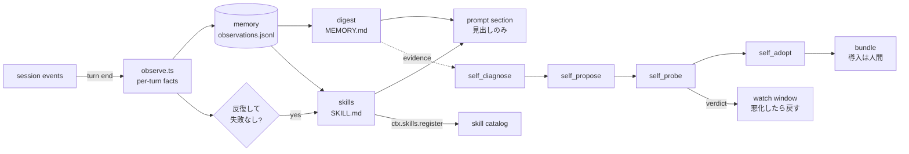

# dsh-self-harness

**測った変更だけを残す、自分で書き換わるハーネス。**

[DeepSeek Harness](https://github.com/deepseek-ai/deepseek-harness)（DSH）のプラグイン。
セッションを観察し、エージェントが何度もつまずく点を見つけ、修正をデータとして書き、二度目の実行で効果を確かめてから採用する。

[](https://github.com/miketako3/dsh-self-harness/actions/workflows/ci.yml)
[](https://www.npmjs.com/package/dsh-self-harness)
[](LICENSE)

[English](README.md) | 日本語

## 自動で起きること

頼まれなくても学ぶ。
ターンが終わるたびに、事実だけを記録する。
どのツールをどの順で呼び、何が失敗し、あなたが訂正したか。
20 ターン分たまると記憶のダイジェストに変わり、同じ手順が失敗なく 3 回続くとスキルになる。
ダイジェストの見出しとスキル名だけがプロンプトに載るので、学んだことを持ちながらプロンプトは太らない。

ハーネスを変えるのは、対比が支持したときだけ。
プロンプトの節、スキルの置き場、ツールの有効化は、どれも Cordis の行である。
つまり候補ハーネスは現在のハーネスとの差分になる。
同じタスクを両方で走らせ、ツールの失敗、手順数、あなたが用意した `verify` を比べ、通ったものだけがバンドルになる。

書き出されるものはすべて `.dsh/self-harness/` の下のファイルである。
読める。
差分も取れる。
消せる。

## モデルなしで見る

`npm run demo` は、プラグインと同じモジュールに合成した 6 ターンを通す。
モデルもネットワークもセッションも使わない。
出力は実際にディスクへ書かれたものである。

```text
digest rewritten after turn 4
distilled auto-read-edit

memory/MEMORY.md
# Memory

_Updated 2026-10-20T09:00:00.000Z from 6 observed turns._

## Working on

- add pagination to the users endpoint (1x)
- add pagination to the orders endpoint (1x)
- add pagination to the invoices endpoint (1x)
- fix the flaky export test (1x)
- add pagination to the audit endpoint (1x)

## What fails

- bash COMMAND_FAILED (1x)

## Procedures

- read > edit (3x)
- read > edit > bash (2x)
- read > bash (1x)

skills/
  auto-read-edit/SKILL.md  (26 lines, generated: true)

prompt index (what the model sees)
  digest headings: Working on, What fails, Procedures
  skills: auto-read-edit
  turns observed: 6
```

失敗したターン（`fix the flaky export test`）は「What fails」に残り、その手順はスキルにならない。
訂正された実行や失敗した実行は、手順が通用する証拠ではないからである。

## 自動で走る範囲

| 段 | 変わるもの | 関門 |
| --- | --- | --- |
| 記憶 | 観察ログ、ダイジェスト、ジャーナル | なし。足すだけ |
| スキル | `skills/<slug>/SKILL.md`、走っているエージェントへの登録 | なし。足すだけ |
| 構成 | プロンプトの行、スキル置き場の行、ツールの切替 | 試行の判定と監視期間。数値が悪化したら自動で戻す |
| コード | 候補のプラグイン本体 | **人間**。`dsh plugin add` |

上の二段は知識である。
実行できず、権限も広げられず、ファイルを消せば元に戻るので、確認せずに走らせる。
三段目はデータの変更で、ループ自身が持ち主で取り消せるので、これも確認なしで走らせるが、監視期間を置いて悪化すれば戻す。
四段目はプロセスで動くコードなので、ループは書いて試すところまでで、動かすかどうかはあなたが決める。

この線は意図的である。
人の承認なしに自分のコードを導入できるエージェントは、最初の悪い変更を内側から反証できない。
考え方は [docs/AUTONOMY.md](docs/AUTONOMY.md) に書いた。

## 導入

```bash
dsh plugin --profile web add dsh-self-harness
```

一度だけ再起動する。
設定は不要で、観察と記憶はそのまま始まる。

```yaml
# $DSH_HOME/profiles/web/cordis.patch.yml
- id: self-harness
  name: dsh-self-harness
  config:
    autonomy: full        # off | memory | skills | full
    baseDir: .dsh/self-harness
    digestEvery: 20       # ダイジェストを書き直すまでのターン数
    distillMinRepeats: 3  # スキルにするまでの連続成功回数
    autoLoop: true        # 15 分間隔の自走を許す
    autoApply: true       # 試行で改善したプロンプト候補を適用する
    watchTurns: 12        # 適用した変更を監視するターン数
```

## ツール

手で回すこともできる。
ループの内部も同じ経路を使う。

| ツール | すること |
| --- | --- |
| `self_diagnose` | いまのハーネスが下手なことを順位づける。ツール失敗率、同じファイルの読み直し、拒否された承認、圧縮の頻度、メッセージ評価。 |
| `self_propose` | 提案役のサブエージェントに候補を一つ書かせる。`candidate.json` と、必要なら `skills/` や `plugin/`。 |
| `self_probe` | 同じタスクを現行と候補で走らせ、比べる。`runs/<id>/report.md` を残す。 |
| `self_adopt` | 試行済みの候補をバンドルにし、教訓を追記する。導入はしない。 |
| `self_status` | 何を学び、何を提案し、各候補がどう評価されたかを出す。 |
| `memory_search` | ダイジェスト、過去のターン、スキルを検索する。 |
| `self_loop` | 診断から適用までを一度だけ回す。15 分間隔の自走と同じ関門を通る。 |

## この形にした理由

DSH はエージェントを Cordis の行の並びから組み立てる。
ハーネスはコードではなくデータである。
だから二つのハーネスを同時に持ち、同じタスクを両方で走らせて比べられる。
自己改善を正直にするのはこの一点で、代わりに「モデルに自分の案を評価させる」ことになる。

[Harness²](https://github.com/google-research/harness2)（Google Research、Apache-2.0）からは三つの考え方だけを借りている。

- **内省より対比。** 編集の良し悪しは、両方のハーネスでタスクを走らせて決める。
- **教訓は証拠と一緒に積む。** 採用のたびに、きっかけ、変更、判定、根拠を `lessons.md` に残す。
- **弱いレバーから試す。** プロンプト、スキル、スクリプト、ツール、フックの順。

Harness² の 8 ファイル構成は取り込んでいない。
DSH の行リストがすでにその構成で、ローダーも付いているからである。

## 構成



読む前に知っておくとよい境界が二つある。

- `plugin/` を持つ候補は別の `dsh` プロセスで走る。検証前のコードが、判定する側のプロセスに載ることはない。
- 承認、サンドボックス方針、プラグインマネージャ、このプラグイン自身に触れる候補は、保存の前と試行の前の二回拒否する。

詳しくは [SECURITY.md](SECURITY.md) にある。

## 開発

```bash
npm install && npm test     # 100 件超。テストフレームワーク依存なし
npm run build
```

変更の多くは機能追加ではなく境界の移動なので、先に [CONTRIBUTING.md](CONTRIBUTING.md) を読んでほしい。

## 状態

v0.2 で、観察、記憶、スキルの蒸留、走っているエージェントへのプロンプト節の追加、自走ループ、セッション内通知、プロンプト候補の自動適用と自動巻き戻しが入る。
行を持つ候補は従来どおりバンドルにして人間が導入する。
UI パネルは [ROADMAP.md](ROADMAP.md) の次の項目である。

## ライセンス

MIT。
Harness² は上の考え方の出典としてクレジットしているが、コードは取り込んでいない。
