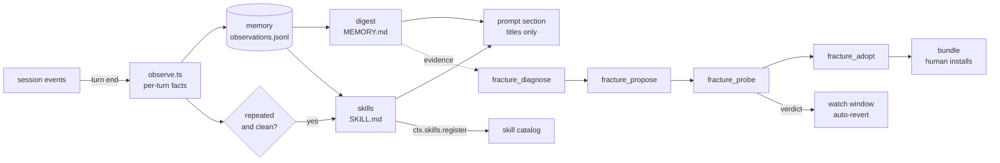

# dsh-fracture

終わったセッションを読み、ハーネスがエージェントをつまずかせている箇所を見つけ、直しをデータとして書き、同じ仕事を二度走らせて効いたかどうかを確かめる DSH プラグイン。

[](https://github.com/miketako3/dsh-fracture/actions/workflows/ci.yml)
[](https://www.npmjs.com/package/dsh-fracture)
[](LICENSE)

[English](README.md) | 日本語

```text
        ┌──────────────────────────── 自分で走る範囲 ────────────────────────────┐
        │                                                                        │
  セッション ──► 観察 ──► 記憶のダイジェスト ──► スキル ──► プロンプトの節      │
        │        (モデルなし)   (20 ターンごと)   (3 回連続成功)                  │
        │                                                                        │
        └──────────── 測ってからでないとハーネスを変えない ─────────────────────┘
                                     │
                     fracture_diagnose ──► fracture_propose ──► fracture_probe ──► fracture_adopt
                        セッションログ      candidate.json       二度の実行を      バンドルと
                          の証拠          行とファイル付き       比較              教訓
```

## これは何か

DSH はエージェントをプラグイン行の並びとして組み立てる。モデル、プロンプトの節、スキルの置き場、ツール、承認のポリシーは、どれも設定を持つ一行である。

行の並びであることから、二つのことが決まる。ハーネスはデータなので、候補のハーネスは今のハーネスとの差分として書ける。そして二つのハーネスを同時に持てるので、変更の良し悪しを、モデルに自分の案を評価させるのではなく、同じ仕事を両方で走らせて比べられる。

名前は作業の比喩である。ハーネスは決まった線に沿って破れる。ファイルを読む前にツールを呼ぶ。作業が終わってから承認を求める。毎朝同じ手順を思い出す。その線が破断面であり、fracture はセッションログからそれを見つけ、残した変更をどれか一本に向ける。

## 解く課題

手入れの時間が取れないまま使われているエージェントには、よく似た三つの失敗がある。

**同じ間違いがセッションを越えて残る**。このプロジェクトは pnpm を使う、このテストは先にフィクスチャを組む必要がある、といった理由でツールが一度失敗する。モデルはその場で解決し、セッションが終わり、次はゼロから始まる。

**ハーネスの調整が勘に頼る**。システムプロンプトを一行直し、雰囲気が良くなった気がして、確かめる手段がないまま残す。次の変更がその上に積まれる。二か月後には、どの行が効いているのか誰も知らない。

**改善が溜まらない**。うまくいったセッションがあっても、うまくいかせた手順は、次のセッションが読める形ではどこにも残らない。

三つの原因は同じところにある。ループは、起きたことを記録しておらず、変更を基準と比べてもいない。fracture はこの二つを足し、人の手を借りずに回す。

## 自動でやること

終わったターンは、文章ではなく事実として記録する。どのツールがどの順で走り、何が失敗し、人間が口を挟んで直したか。20 ターンたまると、記録はダイジェストになる。同じ手順が失敗も訂正もなく 3 回続くと、その手順はスキルになる。ダイジェストとスキルの一覧は、短い索引としてプロンプトに入る。エージェントは、覚えたことを全部持ち歩かずに、何を覚えたかを知っている。

ハーネス自体も変えるが、変えてよい深さは測れる範囲に限る。

| 段 | 変わるもの | 関門 |
| --- | --- | --- |
| 記憶 | 観察、ダイジェスト、ジャーナル | なし。足すだけ |
| スキル | `skills/<slug>/SKILL.md` と実行中の登録 | なし。足すだけ |
| 構成 | プロンプトの行、スキル置き場の行、ツールの切り替え | 試行の判定と監視期間。数字が悪化すれば自動で戻す |
| コード | 候補のプラグイン本体 | **人間**。`dsh plugin add` |

最初の二段は知識である。何も実行せず、権限も広げず、ファイルを消せば元に戻るので、断らずに走る。三段目はループが持ち、自分で取り消せるデータの変更なので、断らずに走るが、そのあと 12 ターン監視し、数字が悪ければ戻す。四段目はあなたのプロセスで動くコードを決めるので、ループは書いて試すところまでにし、動かすかどうかは人間が決める。

この線は意図的に引いてある。自分のコードを自分で入れられるエージェントは、最初の悪い変更を内側から反証できない。

書き出したものはすべて読めるファイルになる。`.dsh/fracture/` の下にある。

スキルを蒸留したとき、変更を適用したとき、巻き戻したときは、折りたたまれた通知が一度だけセッションに出る。ループが黙って何かをすることはない。それ以外のときは出さない。毎ターン通知が出るなら、それはもう情報ではない。

## モデルなしで動きを見る

`npm run demo` は、合成した 6 ターンを、プラグインと同じモジュールに通す。モデルもネットワークもセッションも使わない。以下はその実行結果で、実際にディスクへ書かれたものである。

```text
base directory: /var/folders/…/fracture-demo-xxxx

digest rewritten after turn 4
distilled auto-read-edit

memory/MEMORY.md
# Memory

_Updated 2026-10-20T09:00:00.000Z from 6 observed turns._

## Working on

- add pagination to the users endpoint (1x)
- add pagination to the orders endpoint (1x)
- add pagination to the invoices endpoint (1x)
- fix the flaky export test (1x)
- add pagination to the audit endpoint (1x)

## What fails

- bash COMMAND_FAILED (1x)

## Procedures

- read > edit (3x)
- read > edit > bash (2x)
- read > bash (1x)

skills/
  auto-read-edit/SKILL.md  (26 lines, generated: true)

prompt index (what the model sees)
  digest headings: Working on, What fails, Procedures
  skills: auto-read-edit
  turns observed: 6

journal.md
- 2026-10-20T03:22:04.176Z memory digest rewritten from 4 turns
- 2026-10-20T03:22:04.178Z distilled skill auto-read-edit from 3 clean repetitions
- 2026-10-20T03:22:04.179Z memory digest rewritten from 6 turns
```

失敗したターン（`fix the flaky export test`）は「What fails」に残り、その手順はスキルにならない。失敗した実行や訂正された実行は、その手順が通用する証拠ではないからである。

## 導入

```bash
dsh plugin --profile web add dsh-fracture                     # npm の 0.2.0
dsh plugin --profile web add github:miketako3/dsh-fracture    # main の最新
```

0.2.0 は npm にあり、ループ、記憶、自動適用が入っている。git 形式は `main` を追い、インストール時にビルドするので、公開版より新しいコミットを使いたいときに選ぶ。旧名の `dsh-self-harness` には 0.1.0 が一つあるだけで、ここで説明した機能は入っていない。入れてはいけない。

一度だけ再起動する。設定は要らない。観察と記憶はその場で始まる。

```yaml
# $DSH_HOME/profiles/web/cordis.patch.yml
- id: fracture
  name: dsh-fracture
  config:
    autonomy: full        # off | memory | skills | full
    baseDir: .dsh/fracture
    digestEvery: 20       # ダイジェストを書き直す間隔（ターン）
    distillMinRepeats: 3  # スキルにするまでの連続成功回数
    autoLoop: true        # 15 分ごとの自走を許す
    autoApply: true       # 試行で改善したプロンプト候補を適用する
    watchTurns: 12        # 適用した変更を監視するターン数
```

## ツール

ループはこれらを内部で使う。手で呼ぶこともできる。

| ツール | すること |
| --- | --- |
| `fracture_diagnose` | 今のハーネスが下手なところを順位付けする。ツールの失敗率、同じファイルの読み直し、拒否された承認、圧縮の圧力、メッセージの往復。 |
| `fracture_propose` | 提案役のサブエージェントに、候補を一つ書かせる。`candidate.json` と、必要なら `skills/` か `plugin/`。 |
| `fracture_probe` | 同じ仕事を今のハーネスと候補で走らせ、比べる。`runs/<id>/report.md` を残す。 |
| `fracture_adopt` | 試行済みの候補を導入できるバンドルにし、教訓を追記する。導入そのものはしない。 |
| `fracture_status` | 何を覚え、何を提案し、各候補がどう評価されたか。 |
| `fracture_loop` | 診断から適用までを一度だけ回す。15 分間隔の自走と同じ関門を通る。 |
| `memory_search` | ダイジェスト、過去のターン、蒸留したスキルを検索する。 |

## 参考にしたもの

[Harness²](https://github.com/google-research/harness2)（Google Research、Apache-2.0）から三つの考えを借りている。実装はすべてこのプラグインの中にある。

- **内省より対比**。変更の良し悪しは、両方のハーネスで仕事を走らせて決める。モデルに自分の案を評価させない。
- **教訓は証拠とともに積む**。導入のたびに、きっかけ、変更、判定、理由を `lessons.md` に追記する。
- **弱いレバーから上げる**。プロンプト、スキル、スクリプト、ツール、フックの順に試す。

Harness² の 8 ファイルのハーネス木は採らない。DSH の行の並びがすでにその木で、ローダーと差分が付いている。写すと同じものを二通りに持つことになる。

残りは DSH 自身の仕組みである。構成にはプラグイン行、手順には `SKILL.md` の約束、観察には `session/event`、注入にはエージェント単位のプロンプト節を使う。Harness² のコードは同梱していない。

## 構成



コードを読む前に知っておくべき性質が二つある。

- `plugin/` を持つ候補は別の `dsh` プロセスで走る。検証していないコードが、それを判定するプロセスに読み込まれることはない。
- 承認、サンドボックスのポリシー、プラグインマネージャ、このプラグイン自身に触れる候補は、保存の前と試行の前の二度はじく。

詳しくは [SECURITY.md](SECURITY.md)。段の線をどこに引いたかの理由は [docs/AUTONOMY.md](docs/AUTONOMY.md) にある。

## 開発

```bash
npm install && npm test     # 128 個のテスト。node:test だけを使う
npm run build
npm run demo                # モデルなしでループを回す
```

変更は歓迎するが、[CONTRIBUTING.md](CONTRIBUTING.md) を先に読んでほしい。ここでの変更の多くは機能を足すのではなく、境界を動かす。

## 状態

0.2 で、観察、記憶、スキルの蒸留、走っているエージェントへのプロンプト節、自走ループ、セッション内通知、プロンプト候補の自動適用と自動巻き戻しが入る。行を持つ候補は従来どおりバンドルにして人間が導入する。UI パネルは [ROADMAP.md](ROADMAP.md) の次の項目である。

## ライセンス

MIT。上の三つの考えについて Harness² を明記しており、コードは同梱していない。
