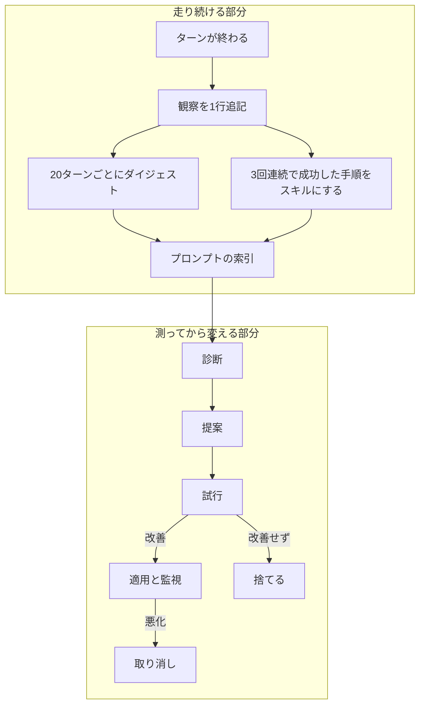

# dsh-fracture

終わったセッションを読み、エージェントの失敗の原因がハーネスにある箇所を見つけ、直しをデータとして書き、同じ仕事を二度実行して改善したかを確かめる DSH プラグインです。

[](https://github.com/miketako3/dsh-fracture/actions/workflows/ci.yml)
[](LICENSE)

[English](README.md) | 日本語

## 構成



上は自動で動く部分、下は測定を経てから変える部分です。
それぞれが何をするのかは [docs/仕組み.md](docs/仕組み.md) に書いてあります。

## できること

ターンが終わるたびに、何が起きたかを事実として記録します。
どのツールがどの順で走り、何が失敗し、あなたが訂正したかです。
このときモデルは呼びません。

20ターンたまると、記録をダイジェストにまとめます。
同じ手順が失敗も訂正もなく3回続くと、その手順をスキルとして書き出し、走っているセッションに登録します。

記録が十分たまると、診断から適用までを自動で実行します。
きっかけは15分ごとのアイドルか、`fracture_loop` を呼んだときです。
適用した変更は12ターン監視し、数字が悪ければ自動で戻します。

コードを含む変更だけは、人間が入れます。

## なぜ作ったか

手入れの時間が取れないまま使っているエージェントには、よく似た失敗が三つあります。

一つは、同じ間違いがセッションを越えて残ることです。
このプロジェクトは pnpm を使う、このテストは先にフィクスチャを組む必要がある、といった理由でツールが一度失敗します。
モデルはその場で解決しますが、セッションが終われば次はゼロからです。

二つめは、ハーネスの調整が勘に頼ることです。
システムプロンプトを一行直し、良くなった気がして、確かめないまま残します。
次の変更がその上に積まれ、二か月後にはどの行が必要なのか誰も分かりません。

三つめは、改善が溜まらないことです。
うまくいったセッションがあっても、うまくいかせた手順は、次のセッションが読める形では残りません。

三つの原因は同じです。
ループが、起きたことを記録しておらず、変更を基準と比べてもいません。
fracture はこの二つを実装し、人間が関与しないまま動かします。

## どこまで自動で変えるか

| 段 | 変わるもの | 条件 |
| --- | --- | --- |
| T0 記憶 | 観察、ダイジェスト、ジャーナル | なし。足すだけ |
| T1 スキル | `skills/<slug>/SKILL.md` と実行中の登録 | なし。足すだけ |
| T2 構成 | プロンプト節、スキルの置き場、ツールの切り替え | 試行の判定と監視期間。数字が悪化すれば自動で戻す |
| T3 コード | プラグイン本体 | **人間**。`dsh plugin add` |

T0 と T1 は記録とスキルだけで、実行できるものを増やさず、権限も広げません。
ファイルを消せば元に戻るので、人間の確認を挟みません。

T2 は振る舞いを変えるので、試行と監視を付けます。
それでも人間の確認を挟まないのは、プラグイン自身が持ち、自分で取り消せるデータの変更だからです。

T3 はプロセスで動くコードを決めます。
ループは書いて試すところまでを自動でやり、動かすかどうかは人間が決めます。
自分でコードを入れられるエージェントは、最初の悪い変更が悪かったことを自分では検出できません。

スキルを書き出したとき、変更を適用したとき、巻き戻したときは、折りたたまれた通知が一度だけセッションに出ます。
それ以外のときは出しません。
毎ターン通知が出るなら、それはもう情報ではありません。

## 導入

```bash
dsh plugin --profile web add github:miketako3/dsh-fracture
```

これが配布の経路です。
リポジトリから取得し、インストール時にビルドします。

pnpm は git から取ったパッケージのビルドを既定で止めます。
最初のインストールは、次のエラーで終わります。

```text
[ERR_PNPM_GIT_DEP_PREPARE_NOT_ALLOWED] Failed to prepare git-hosted package
```

メッセージに出る `allowBuilds` の行を、そのまま `$DSH_HOME/profiles/web/pnpm-workspace.yaml` に足して、もう一度実行してください。
行には取得したコミットのハッシュが入ります。
main が進むとハッシュが変わるので、更新のたびに同じ手順が要ります。

```yaml
allowBuilds:
  dsh-fracture@https://codeload.github.com/miketako3/dsh-fracture/tar.gz/<hash>: true
```

一度だけ再起動してください。
設定は要りません。
観察と記憶はその場で始まります。

## 設定

```yaml
# $DSH_HOME/profiles/web/cordis.patch.yml
- id: fracture
  name: dsh-fracture
  config:
    autonomy: full        # off | memory | skills | full
    baseDir: .dsh/fracture
    digestEvery: 20       # ダイジェストを書き直す間隔（ターン）
    distillMinRepeats: 3  # スキルにするまでの連続成功回数
    autoLoop: true        # 15分ごとの自動実行を許す
    autoApply: true       # 試行で改善したプロンプト候補を適用する
    watchTurns: 12        # 適用した変更を監視するターン数
    maxWatches: 3         # 同時に監視できる変更の数
    judge: off            # off | rubric。検査の無い候補を別のモデルに採点させる
```

| 設定 | 既定 | 説明 |
| --- | --- | --- |
| `autonomy` | `full` | `off`、`memory`、`skills`、`full` の順に、許す段が増えます |
| `baseDir` | `.dsh/fracture` | 記録と候補の置き場です |
| `digestEvery` | `20` | ダイジェストを書き直す間隔です |
| `distillMinRepeats` | `3` | スキルにするまでの連続成功回数です |
| `autoLoop` | `true` | 15分ごとの自動実行を許します |
| `autoApply` | `true` | 試行で改善したプロンプト候補を適用します |
| `watchTurns` | `12` | 適用した変更を監視するターン数です |
| `maxWatches` | `3` | 同時に監視できる変更の数です |
| `judge` | `off` | `rubric` にすると、検査の無い候補を別のモデルが5段階で採点します |

## ツール

ループはこれらを内部で使います。
ツールとして直接呼ぶこともできます。

| ツール | すること |
| --- | --- |
| `fracture_diagnose` | 今のハーネスで問題が起きている順に並べます。ツールの失敗率、同じファイルの読み直し、拒否された承認、圧縮の圧力、メッセージの評価を見ます |
| `fracture_propose` | 提案役のサブエージェントに、候補を一つ書かせます。`candidate.json` と、必要なら `skills/` か `plugin/` です |
| `fracture_probe` | 同じ仕事を今のハーネスと候補で実行し、比べます。`runs/<id>/report.md` を残します |
| `fracture_plan` | 依頼を、確かめられる受け入れ条件に変える。作れないときは、作れないと答える |
| `fracture_adopt` | 試行済みの候補を導入できるバンドルにし、教訓を追記します。導入そのものはしません |
| `fracture_status` | 何を記録し、何を提案し、各候補がどう評価されたかを返します |
| `fracture_loop` | 診断から適用までを一度だけ実行します。15分ごとの自動実行と同じ条件を通ります |
| `memory_search` | ダイジェスト、過去のターン、書き出したスキルを検索します |

## ドキュメント

| 文書 | 内容 |
| --- | --- |
| [docs/仕組み.md](docs/仕組み.md) | 設計、4つの段、いつ動くか、監視の閾値、変更してはいけない範囲 |
| [CONTRIBUTING.md](CONTRIBUTING.md) | 開発の進め方、リリースの手順、変更が境界を動かすときに求めていること |
| [SECURITY.md](SECURITY.md) | 何を脆弱性として扱い、どこからが仕様か |
| [CHANGELOG.md](CHANGELOG.md) | 版ごとの変更点 |

## 参考にしたもの

[Harness²](https://github.com/google-research/harness2)（Google Research、Apache-2.0）から三つの考えを借りています。
実装はすべてこのプラグインの中にあり、コードは同梱していません。

- **内省より対比。** 変更の良し悪しは、両方のハーネスで仕事を実行して決めます。モデルに自分の案を評価させません。
- **教訓は証拠とともに積む。** 導入のたびに、きっかけ、変更、判定、理由を `lessons.md` に追記します。
- **弱いレバーから上げる。** プロンプト、スキル、スクリプト、ツール、フックの順に試します。

Harness² の8ファイルのハーネス木は採りませんでした。
DSH の行の並びがすでにその木で、ローダーと差分が付いています。
写せば同じものを二通りに持つことになります。

残りは DSH 自身の仕組みです。
構成にはプラグイン行、手順には `SKILL.md` の約束、観察には `session/event`、注入にはエージェント単位のプロンプト節を使っています。

## 開発

```bash
npm install && npm test     # 128個のテスト。node:test だけを使います
npm run build
npm run demo                # 合成ターンでループを一周させます
```

変更は歓迎します。
ただし、[CONTRIBUTING.md](CONTRIBUTING.md) を先に読んでください。
ここでの変更の多くは、機能を足すのではなく、境界を動かすからです。

## ライセンス

MIT です。
Harness² の三つの考えについては出典を明記しており、コードは同梱していません。
