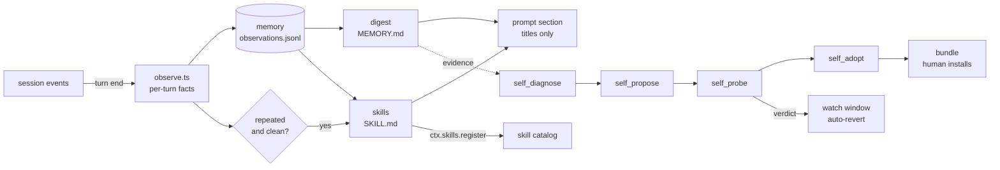

# dsh-self-harness

**A harness that rewrites itself, one measured change at a time.**

A [DeepSeek Harness](https://github.com/deepseek-ai/deepseek-harness) (DSH) plugin that watches your sessions, learns what your agent keeps fumbling, writes the fix as data, and proves it on a second run before keeping it.

[](https://github.com/miketako3/dsh-self-harness/actions/workflows/ci.yml)
[](https://www.npmjs.com/package/dsh-self-harness)
[](LICENSE)
[](package.json)

English | [日本語](README.ja.md)

```text
        ┌──────────────────────────── runs on its own ───────────────────────────┐
        │                                                                        │
  your session ──► observations ──► memory digest ──► skills ──► prompt section  │
        │              (no model)      (every 20 turns)  (3 clean repeats)       │
        │                                                                        │
        └──────────── asks before it changes how you work ──────────────────────┘
                                     │
                     self_diagnose ──► self_propose ──► self_probe ──► self_adopt
                        session log     candidate.json     two runs      bundle +
                         evidence       + rows/files      compared       lesson
```

## Two things happen

**It learns without being asked.** Every finished turn is recorded as facts, not prose: which tools ran, in what order, what failed, whether you had to correct it. After twenty turns the log becomes a memory digest. After three clean repetitions of the same procedure, that procedure becomes a skill. The digest and the skill list are injected into the prompt as a small index, so the agent knows what it has learned without carrying the whole store.

What it does is visible: a distilled skill, an applied change, and a revert each post one collapsed notice into the session. You do not have to read the journal to know the loop touched something.

**It changes the harness only when a contrast says it should.** A prompt section, a skill directory, a tool toggle: those are rows in a plugin list, so a candidate harness is a diff against the current one. The plugin runs the same task twice, once on each harness, and compares tool errors, steps, and the deterministic `verify` command you supplied. Only a passing contrast becomes a bundle.

Everything it writes is a file you can read: `.dsh/self-harness/`.

## See it without a model

`npm run demo` feeds six synthetic turns through the same modules the plugin runs. No model, no network, no session. The output is what landed on disk:

```text
base directory: /var/folders/…/self-harness-demo-xxxx

digest rewritten after turn 4
distilled auto-read-edit

memory/MEMORY.md
# Memory

_Updated 2026-10-20T09:00:00.000Z from 6 observed turns._

## Working on

- add pagination to the users endpoint (1x)
- add pagination to the orders endpoint (1x)
- add pagination to the invoices endpoint (1x)
- fix the flaky export test (1x)
- add pagination to the audit endpoint (1x)

## What fails

- bash COMMAND_FAILED (1x)

## Procedures

- read > edit (3x)
- read > edit > bash (2x)
- read > bash (1x)

skills/
  auto-read-edit/SKILL.md  (26 lines, generated: true)

prompt index (what the model sees)
  digest headings: Working on, What fails, Procedures
  skills: auto-read-edit
  turns observed: 6

journal.md
- 2026-10-20T03:22:04.176Z memory digest rewritten from 4 turns
- 2026-10-20T03:22:04.178Z distilled skill auto-read-edit from 3 clean repetitions
- 2026-10-20T03:22:04.179Z memory digest rewritten from 6 turns
```

The turn that failed (`fix the flaky export test`) is in "What fails" and its procedure never became a skill, because a corrected or failing run is not evidence that a procedure works. That is the whole idea in one screen.

## What runs by itself

| Tier | Changes | Gate |
| --- | --- | --- |
| Memory | observations, digest, journal | none, additive |
| Skills | `skills/<slug>/SKILL.md`, registered live | none, additive |
| Composition | prompt rows, skill-dir rows, tool toggles | probe verdict plus a watch window, auto-revert on regression |
| Code | a candidate plugin module | **human**: `dsh plugin add` |

The first two tiers are knowledge. They cannot execute, cannot widen permissions, and are removed by deleting a file, so they run without asking. The third is a data change the loop owns and can undo, so it runs without asking but is watched and reverted if the numbers get worse. The fourth changes what code runs in your process, so the loop may author it and probe it, and you decide whether it runs.

That line is deliberate. An agent that can install its own code without a human is an agent whose first bad change is unfalsifiable from the inside. Reasoning in [docs/AUTONOMY.md](docs/AUTONOMY.md).

## Install

```bash
dsh plugin --profile web add dsh-self-harness
```

Restart once. No configuration is required: observation and memory start immediately.

```yaml
# $DSH_HOME/profiles/web/cordis.patch.yml
- id: self-harness
  name: dsh-self-harness
  config:
    autonomy: full        # off | memory | skills | full
    baseDir: .dsh/self-harness
    digestEvery: 20       # observed turns between digest rewrites
    distillMinRepeats: 3  # clean repetitions before a skill is written
    autoLoop: true        # let the 15 minute idle trigger run the whole loop
    autoApply: true       # apply a prompt-only candidate that probed improved
    watchTurns: 12        # turns watched before an applied change is kept
```

## Tools

The slow path is also callable by hand, and it is what the loop uses internally.

| Tool | What it does |
| --- | --- |
| `self_diagnose` | Ranks what the current harness does badly: tool failure rates, repeated reads, denied approvals, compaction pressure, message feedback. |
| `self_propose` | Sends a proposer subagent to write one candidate as `candidate.json` plus optional `skills/` or `plugin/`. |
| `self_probe` | Runs a task on the current harness and on the candidate, then compares. Writes `runs/<id>/report.md`. |
| `self_adopt` | Turns a probed candidate into an installable bundle and appends the lesson. Never installs. |
| `self_status` | What was learned, what was proposed, how each candidate scored. |
| `memory_search` | Searches the digest, past turns, and distilled skills. |
| `self_loop` | Runs diagnose → propose → probe → apply once, with the same gates the idle trigger uses. |

## Why this shape

DSH composes an agent from an ordered list of Cordis plugin rows. A harness is therefore **data**: a prompt section, a skill root, a tool, a policy are all rows. Holding two harnesses at once and comparing them becomes cheap, which is what makes a self-improving loop honest — the alternative is asking a model whether its own idea sounds good.

Three ideas are borrowed from [Harness²](https://github.com/google-research/harness2) (Google Research, Apache-2.0):

- **Contrast beats introspection.** Judge the edit by running the task on both harnesses.
- **Lessons accumulate with evidence.** Each adoption appends the cue, the change, the verdict, and a rationale to `lessons.md`.
- **Escalate from the weakest lever.** Prompt before skill, skill before script, script before tool, tool before hook.

Its eight-file harness tree is deliberately not adopted: DSH's row list already is that tree, with a loader.

## Architecture



Two safety properties worth knowing before reading the code:

- A candidate that ships a `plugin/` directory runs in a **separate `dsh` process**, so unverified code never loads in the process judging it.
- Candidates that touch approval, sandbox policy, the plugin manager, or this plugin are rejected before they are stored, and again before they are probed.

Details in [SECURITY.md](SECURITY.md).

## Development

```bash
npm install && npm test     # 100+ tests, no test framework dependency
npm run build
```

Contributions welcome; read [CONTRIBUTING.md](CONTRIBUTING.md) first, because most changes here move a boundary rather than add a feature.

## Status

v0.2 ships observation, memory, skill distillation, the live prompt section, an unattended loop, in-session notices, and automatic apply with auto-revert for prompt-level candidates. Row-shaped candidates still go through a bundle and a human. A UI panel is the next item in [ROADMAP.md](ROADMAP.md).

How a change is applied without a restart, and why that is narrower than "rewrite the harness": [docs/AUTONOMY.md](docs/AUTONOMY.md#the-shape-of-an-automatic-apply).

## License

MIT. Harness² is credited for the ideas above and is not vendored.
