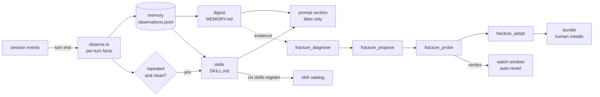

# dsh-fracture

A DSH plugin that reads your finished sessions, finds where the harness makes the agent fail, writes the fix as data, and runs the task twice to check whether the fix helped.

[](https://github.com/miketako3/dsh-fracture/actions/workflows/ci.yml)
[](LICENSE)

English | [日本語](README.ja.md)

## Architecture



Two properties matter before reading the code:

- A candidate that ships a `plugin/` directory runs in a separate `dsh` process, so unverified code never loads in the process that judges it.
- Candidates that touch approval, sandbox policy, the plugin manager, or this plugin are rejected before they are stored, and again before they are probed.

The reasoning behind the tier boundaries is in [docs/仕組み.md](docs/仕組み.md) (Japanese).

## What it is

DSH builds an agent out of an ordered list of plugin rows. A model, a prompt section, a skill root, a tool, an approval policy: each is a row with its own config.

Two consequences follow. A harness is data, so a candidate harness is a diff against the current one. And two harnesses can exist at the same time, so a change can be judged by running the same task on both instead of asking a model whether its own idea sounds good.

## The problem

Three failures are common in a setup that nobody has time to tune.

**The same mistake outlives the session.** A tool fails because the project uses pnpm, or because the fixture has to be built before the test runs. The model works it out, the session ends, and the next session starts from nothing.

**Harness tuning is guesswork.** Someone edits the system prompt, decides the agent feels better, and has no way to check. The edit stays. The next edit lands on top of it. Two months later nobody knows which line matters.

**Nothing accumulates.** When a session goes well, the procedure that made it go well is not written down anywhere the next session can read.

All three have the same cause: nothing in the loop records what happened, and nothing tests a change against a baseline. Fracture adds both, and lets them run unattended.

## What it does

It records every finished turn as facts rather than prose: which tools ran, in which order, what failed, whether you had to step in and correct it. After twenty turns that log becomes a digest. After three clean repetitions of one procedure, the procedure becomes a skill. The digest and the skill list go into the prompt as a short index, so the agent knows what it has learned without loading everything it has recorded.

It also changes the harness, but only where a measurement supports the change, and the depth of what it may change on its own is bounded:

| Tier | What changes | Gate |
| --- | --- | --- |
| Memory | observations, digest, journal | none, additive |
| Skills | `skills/<slug>/SKILL.md`, registered live | none, additive |
| Composition | prompt rows, skill-dir rows, tool toggles | probe verdict plus a watch window, auto-revert on regression |
| Code | a candidate plugin module | **human**: `dsh plugin add` |

The first two tiers are knowledge. They cannot execute anything, cannot widen a permission, and are removed by deleting a file, so they run without asking. The third is a data change the loop owns and can undo, so it runs without asking but is watched for twelve turns afterwards and reverted if the numbers get worse. The fourth decides what code runs inside your process, so the loop may author it and probe it, and you decide whether it runs.

That last line is deliberate. An agent that can install its own code needs no human in the loop to do it, and its first bad change would then be the one change it cannot detect from the inside.

Everything it writes is a file you can read: `.dsh/fracture/`.

A distilled skill, an applied change, and a revert each post one collapsed notice into the session, so the loop never acts silently. Nothing else does, because a notice per turn stops being information.

## Install

```bash
dsh plugin --profile web add github:miketako3/dsh-fracture
```

That is the distribution path. It installs from the repository and builds the package on the way in.

pnpm refuses to run build scripts of a git-hosted package by default, so the first attempt fails with `ERR_PNPM_GIT_DEP_PREPARE_NOT_ALLOWED`. Copy the `allowBuilds` line the error prints into `$DSH_HOME/profiles/web/pnpm-workspace.yaml` and run the command again. The key contains the fetched commit hash, so it changes whenever main moves.

Restart once. No configuration is required: observation and memory start immediately.

```yaml
# $DSH_HOME/profiles/web/cordis.patch.yml
- id: fracture
  name: dsh-fracture
  config:
    autonomy: full        # off | memory | skills | full
    baseDir: .dsh/fracture
    digestEvery: 20       # observed turns between digest rewrites
    distillMinRepeats: 3  # clean repetitions before a skill is written
    autoLoop: true        # let the 15 minute idle trigger run the whole loop
    autoApply: true       # apply a prompt-only candidate that probed improved
    watchTurns: 12        # turns watched before an applied change is kept
```

## Tools

The loop uses these internally, and any of them can be called by hand.

| Tool | What it does |
| --- | --- |
| `fracture_diagnose` | Ranks what the current harness does badly: tool failure rates, repeated reads, denied approvals, compaction pressure, message feedback. |
| `fracture_propose` | Sends a proposer subagent to write one candidate as `candidate.json` plus optional `skills/` or `plugin/`. |
| `fracture_probe` | Runs a task on the current harness and on the candidate, then compares. Writes `runs/<id>/report.md`. |
| `fracture_adopt` | Turns a probed candidate into an installable bundle and appends the lesson. Never installs. |
| `fracture_status` | What was learned, what was proposed, how each candidate scored. |
| `fracture_loop` | Runs diagnose → propose → probe → apply once, with the same gates the idle trigger uses. |
| `memory_search` | Searches the digest, past turns, and distilled skills. |

## Documentation

| File | Contents |
| --- | --- |
| [README.ja.md](README.ja.md) | The same introduction in Japanese |
| [docs/仕組み.md](docs/仕組み.md) | How it works: the four tiers, the triggers, the watch window, the protected surface |
| [CONTRIBUTING.md](CONTRIBUTING.md) | Development rules and what a good pull request looks like |

The design and contribution documents are written in Japanese. That is a deliberate choice: they are read by the person who maintains the loop, and a translated design document loses the precision that makes it useful.

## Where the ideas come from

[Harness²](https://github.com/google-research/harness2) (Google Research, Apache-2.0) is the direct source for three ideas, all of which this plugin implements:

- **Contrast beats introspection.** Judge an edit by running the task on both harnesses, not by asking a model to review it.
- **Lessons accumulate with evidence.** Every adoption appends the cue, the change, the verdict, and a rationale to `lessons.md`.
- **Escalate from the weakest lever.** Prompt before skill, skill before script, script before tool, tool before hook.

Harness²'s eight-file harness tree is deliberately not adopted. DSH's row list already is that tree, with a loader and a diff, so copying the tree would add a second way to describe the same thing.

The rest is DSH's own material: plugin rows for composition, the `SKILL.md` convention for procedures, `session/event` for observation, and scoped prompt sections for injection. No Harness² code is vendored.

## Development

```bash
npm install && npm test     # 128 tests, node:test only
npm run build
npm run demo                # one loop over synthetic turns
```

Contributions are welcome, but read [CONTRIBUTING.md](CONTRIBUTING.md) first, because most changes here move a boundary rather than add a feature.

## Status

0.2 covers observation, memory, skill distillation, the live prompt section, the unattended loop, in-session notices, and automatic apply with auto-revert for prompt-level candidates. Row-shaped candidates still go through a bundle and a human.

## License

MIT. Harness² is credited for the ideas above and is not vendored.
