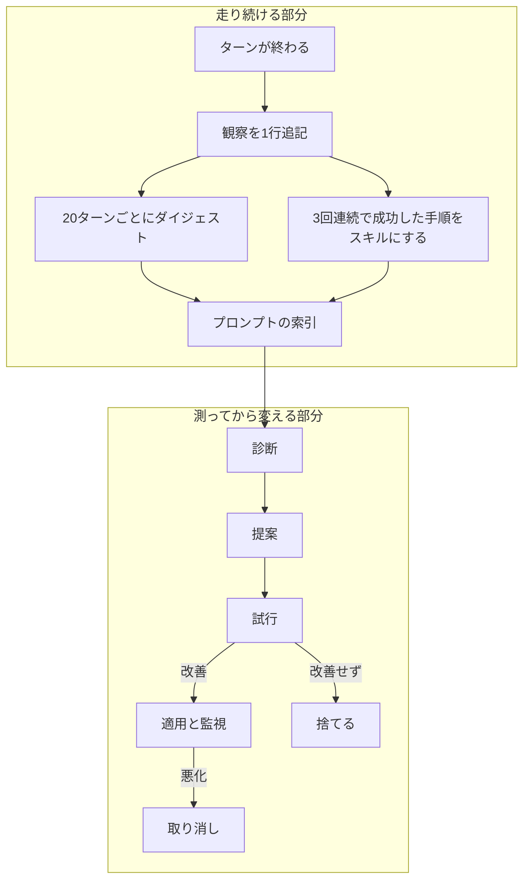
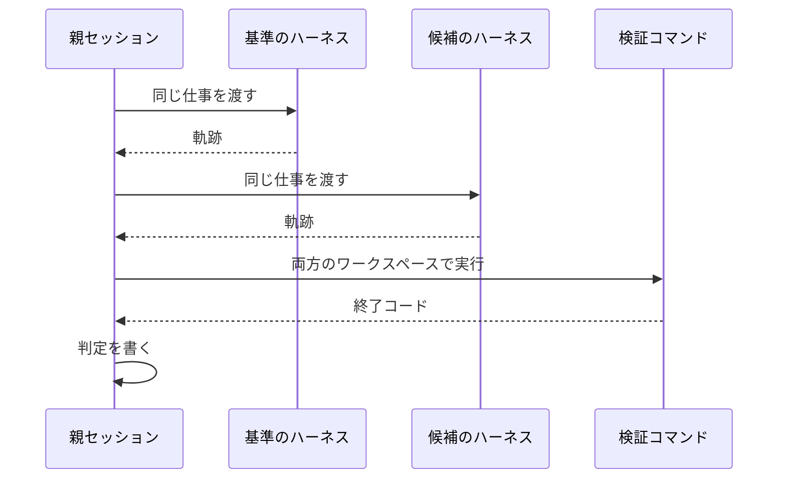
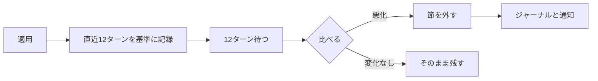

# 仕組み

この文書は、dsh-fracture が内部で何をしているかを説明します。
README が「何ができるか」を、この文書が「なぜそうなっているか」を担当します。
読み終えると、どの変更が自動で入り、どれに人間の判断が必要かを、理由つきで説明できるようになります。

## 1. 全体像



エージェントの応答は、DSH が毎回組み立て直します。
そのため、走っているセッションにプロンプト節を一つ足せば、次の応答から振る舞いが変わります。
fracture はこの性質を使って、再起動なしにハーネスを変えます。

ただし、プリセット（行の並び）そのものは空のセッションにしか結び付けられません。
走ったことのあるセッションに別のプリセットを結び直すと、そのセッションは壊れます。
自動適用がプロンプト節に限られているのは、この制約のためです。

## 2. 4つの段

変えてよい深さを、危険度の順に四つに分けています。

| 段 | 変わるもの | 試行 | 承認 | 戻し方 |
| --- | --- | --- | --- | --- |
| T0 記憶 | 観察、ダイジェスト、ジャーナル | なし | なし | ファイルを消す |
| T1 スキル | `skills/<slug>/SKILL.md` と実行中の登録 | なし | なし | ファイルを消す |
| T2 構成 | プロンプト節、スキルの置き場、ツールの切り替え | 必須 | なし。監視して悪化すれば自動で戻す | 節を外す |
| T3 コード | プラグイン本体、フック、UI | 必須 | **人間** | バンドルを外す |

T0 と T1 は記録とスキルだけで、実行できるものを増やさず、権限も広げません。
ファイルを消せば元に戻るので、人間の確認を挟みません。

T2 は振る舞いを変えるので、試行で証拠を取ってから適用し、そのあと監視期間を置きます。
それでも人間の確認を挟まないのは、プラグイン自身が持ち、自分で取り消せるデータの変更だからです。

T3 はプロセスで動くコードを決めます。
ループは書くところまでと試すところまでを自動でやりますが、入れるかどうかは人間が決めます。
自動で入れられると、ループはシステムで最も強い権限を持つ主体になり、最初の悪い変更が悪かったことを自分では検出できなくなります。

## 3. ループの道具

自動で動く場合も、直接呼ぶ場合も、同じ道具を使います。

```text
fracture_plan → fracture_diagnose → fracture_propose → fracture_probe → fracture_adopt
    受け入れ条件        証拠              候補             対比            成果物
```

`fracture_plan` だけは、ループの前に置きます。
依頼を確かめられる条件に変えられないと、試行は何も判定できず、改善は測れません。

### 3.0 受け入れ条件

依頼を、終わったかどうかを判定できる条件に変えます。

| 種別 | 何を書くか | 誰が判定するか |
| --- | --- | --- |
| `command` | 未完了なら非ゼロで終わるコマンド | 試行が実行する |
| `check` | 記録から読み取れる条件 | 採点が読む |

`command` を優先し、`check` は成果物を残さない仕事にだけ使います。
条件は2つから5つまでです。
条件を作れない依頼は、作れないと答えます。
そこが人間の判断を要する箇所であり、ループが回してよい場所ではないからです。

書いた条件は `criteria/<id>.json` に残ります。
同じ依頼が来たときは、それを再利用します。
`fracture_probe` は、候補が自前の `verify` を持たないとき、この条件のうち最初の `command` を検査に使います。

### 3.1 診断

診断は、保存されたセッションイベントに対する算術です。
意見ではなく、数を出します。

| 見るもの | 数え方 |
| --- | --- |
| ツールの失敗 | 呼び出し回数と失敗回数。失敗率の順に並べる |
| 同じファイルの読み直し | 1セッション内で同じパスを3回以上読んだ回数 |
| 承認の拒否 | 拒否された承認の件数 |
| 文脈の圧縮 | 圧縮が起きた回数 |
| メッセージの評価 | フィードバックが記録されている場合の評価 |
| トークン | プロバイダが使用量を返す場合の合計 |

一度の不運な失敗が所見にならないよう、下限を置いています。
ツールは3回以上の呼び出しと30パーセント以上の失敗率、同じパスは3回の読み直し、拒否は2件です。

評価は既定で信頼します。
評価は回答に対する人間の発言であり、低い評価は手に入る中で最も強い安価な信号です。
ただし、それだけでは足りません。
所見は数で説明できなければならず、評価だけでは何を変えるかが決まらないからです。

### 3.2 提案

提案は、その変更と暮らすことになるセッションではなく、**サブエージェント**が行います。
理由は二つあります。

一つは文脈の隔離です。
提案役はリポジトリと診断結果を読めますが、その探索の記録が作業中のセッションを汚しません。

もう一つは責任の分離です。
提案役はファイルを書き、親が検証します。
提案役が失敗したときに残るのは、拒否された候補であって、壊れたハーネスではありません。

提案役は何も導入できません。
出すものはディレクトリ一つです。

```text
candidates/<id>/
├── candidate.json      # 行、根拠、所見、レバー、任意の検証コマンド
├── skills/<name>/…     # 任意
└── plugin/index.js     # 任意
```

検証はサブエージェントが戻ったあと、親が行います。
JSON の形、行の数、変更してはいけない範囲かどうかを見ます。
拒否するときは、間違いを一度に全部伝えます。
そうしないと、やり直しに使える情報が残りません。

### 3.3 試行

ここがループの中心で、制約が最も多い場所です。

試行は、同じ仕事を今のハーネスと候補の両方で実行し、比べます。
プロンプトの文面、ワークスペースの中身、使えるツールは同じで、違うのは候補の行だけです。

実行の経路は二つあり、どちらになるかは候補が `plugin/` を持つかで決まります。

| 候補 | 走る場所 | 理由 |
| --- | --- | --- |
| 行だけ（プロンプト節、スキルの置き場、切り替え、既存ツール） | DSH プロセス内の子エージェント | 参照するモジュールはすでに読み込まれている。新しいコードは実行されない |
| コードを含む（`plugin/index.js`） | 別の `dsh` プロセス | 検証していないコードを、それを判定するセッションと同じプロセスで動かさない |



二つの実行には別々のワークスペースを渡します。
試行の仕事はたいていファイルを書き換えるからです。
`node_modules` と `.git` を複製すると費用が大きくなるので、複製せず元へシンボリックリンクを張ります。
ビルド成果物（`dist`、`build`、`.next`、`target` など）は複製せず、fracture 自身の作業ディレクトリも除外します。
試行が過去の実行結果を複製しないようにするためです。

判定は、候補が検証コマンドを宣言している場合、その終了コードで決まります。
宣言がない場合は `needs-review` になり、二つの実行の軌跡を人間に見せます。

`judge: rubric` を設定したときだけ、別のモデルが両方の軌跡を5段階で採点します。
採点はループで最も弱い証拠です。
一つのモデルが二つの文章を読んだ印象なので、レポートにもそう書きます。
判定は点数の差から決め、モデルが「良くなった」と書いていても点数が低ければ退けたと記録します。
決定的な検査があるときは、採点を呼びません。

二つの実行の軌跡は `[ACTION]` と `[OBSERVATION]` の組で書き出します。
これは Harness² の考え方で、コードは借りていません。
二つの実行を目でも差分でも比べられるようにするためです。

### 3.4 導入

試行の結果は証拠であって、許可ではありません。
だから導入は別の道具にしています。

- 直近の試行が `improved` でなければ受け付けません。`force` を付けた場合だけ実行します。
- バンドルを作ります。`cordis.patch.yml`、`dsh.bundle.patch` を宣言した `package.json`、候補の `plugin/` と `skills/` です。
- 候補からの相対パスで書かれた行は、バンドルのパッケージ名に書き換えます。ファイルは同じで、読み込み方だけが変わります。
- `lessons.md` に一節を追記します。
- 導入そのものはしません。導入は `dsh plugin add` か `plugin_manager` ツールで、この承認が、自己改変に対して人間が判断する箇所です。

自分の設定ファイルに行を並べたい人のために、プロファイルのパッチに追記する方法も用意していますが、既定では有効にしません。

## 4. いつ動くのか

| きっかけ | 動く段 | 頻度 |
| --- | --- | --- |
| ターンの終わり | T0 | 毎ターン |
| ターンが8回進んだ | T1、T2 | 窓ごとに一度まで |
| セッションの終わり | T0 の要約、T1 | セッションごとに一度 |
| 15分のアイドル | T1、T2 | ターンが動いていないときだけ |
| ツールを直接呼ぶ | すべて | 要求があれば |

利用者の作業を妨げないように、次の決まりを置いています。

- ターンが動いている間に試行を始めない。
- 同時に走るループは一つだけ。
- T2 の変更を適用したら、監視期間が終わるまで次の T2 を始めない。
- 内部の失敗が2回続いたら、autonomy を `memory` に落とし、理由をジャーナルに書く。

## 5. 適用と監視



適用した時点で、直前 `watchTurns` ターンの指標を基準として記録します。
監視期間が来たら、適用の刻印より後に記録されたターンだけを比べます。

監視は同時に3つまで開けます（`maxWatches`）。
1つに限ると、12ターンごとに1回しか改善が進まず、残りは判定待ちになります。
重ねた場合、指標はそれぞれの適用前を基準にします。
同時に効いている変更が二つあると、動いた数値がどちらによるものかは分かりません。
そのため取り消すときは変更の名前を指定し、ジャーナルにも名前を残します。

| 指標 | 取り消す条件 |
| --- | --- |
| ツールの失敗率 | 5ポイントを超えて上がった |
| ターンあたりの手順数 | 25パーセントを超えて増えた |
| プロンプトのトークン | 15パーセントを超えて増えた。試行が最初の手順で使った数値を基準に使う |

取り消しもまた変更です。
記録し、通知し、数えます。
2回続けて取り消したら、そのセッションでは T2 を止めます。

監視の目的は、変更が良かったことを証明することではありません。
悪い変更の損害を、一週間ではなく監視期間一回分にすることです。

## 6. 変更させない範囲

ループは、自分を制限する規則を変えられてはいけません。
`src/guard.ts` は、次の名前を含む行を持つ候補を拒否します。

| 対象 | 理由 |
| --- | --- |
| `dsh-user-approval` | 承認を弱める候補は、以後のすべての候補を通しやすくする |
| `dsh-sandbox-policy` | 同様。ファイルとプロセスの境界を動かす |
| `plugin_manager` | パッケージを入れられる候補は、何でも入れられる |
| `dsh-fracture` | 走っている間に自分を書き換えると、対象が定まらない |

判定は名前の部分一致なので、慎重側に寄っています。
`approval` を含むだけの無害な行も拒否します。
誤って拒否する損害は提案一回分ですが、誤って通す損害は境界そのものなので、この偏りは意図しています。

## 7. 後始末

試行が持ち、試行より後に残ってはいけない資源が二つあります。

| 資源 | 解放しないとどうなるか | いつ解放するか |
| --- | --- | --- |
| 候補のプリセット | 登録が残り、次の試行の番号がずれる | `finally` で、登録時の disposer を呼ぶ |
| 子エージェント | 止まらずに動き続け、トークンを消費し続ける | `finally` で、結果を待ってから `dispose()` する |

プリセットの登録は失敗しても例外になりません。
登録簿に `broken` として記録され、登録自体は成功したように見えます。
この確認を省くと、試行は基準の行を実行して、読み込まれなかった変更の結果を報告します。
だから試行は、登録したプリセットを読み直し、壊れていれば中止します。

## 8. 計測していること、していないこと

| 計測する | 出どころ |
| --- | --- |
| ツールの呼び出しと結果 | セッションイベント。失敗の種類も含む |
| 承認の判断 | 承認イベント |
| 圧縮の回数 | 圧縮イベント |
| トークン使用量 | アシスタントのメッセージ |
| メッセージの評価 | フィードバックのプラグインが入っている場合 |

次の二つは、まだ計測していません。

- **導入前後の初回プロンプトのトークン数。** `ctx.tokenMeter` で取れますが、配線していません。それまでは、導入したプロンプト節の費用は未検証です。
- **採点による判定。** 3.3 のとおり、決定的な検証コマンドを優先します。
